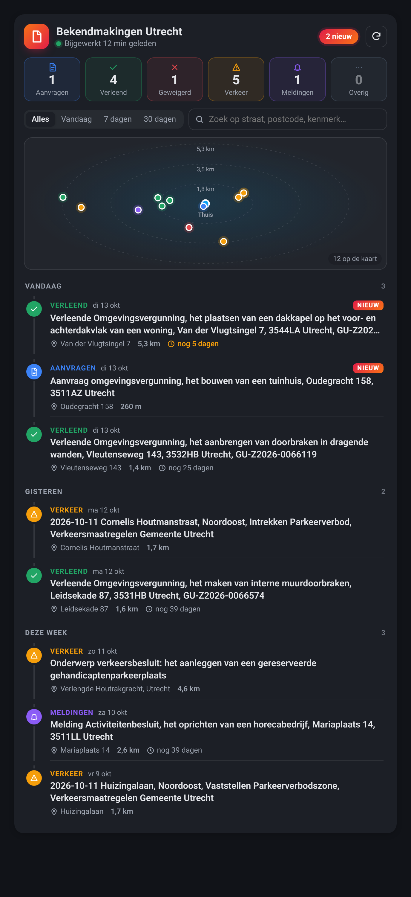
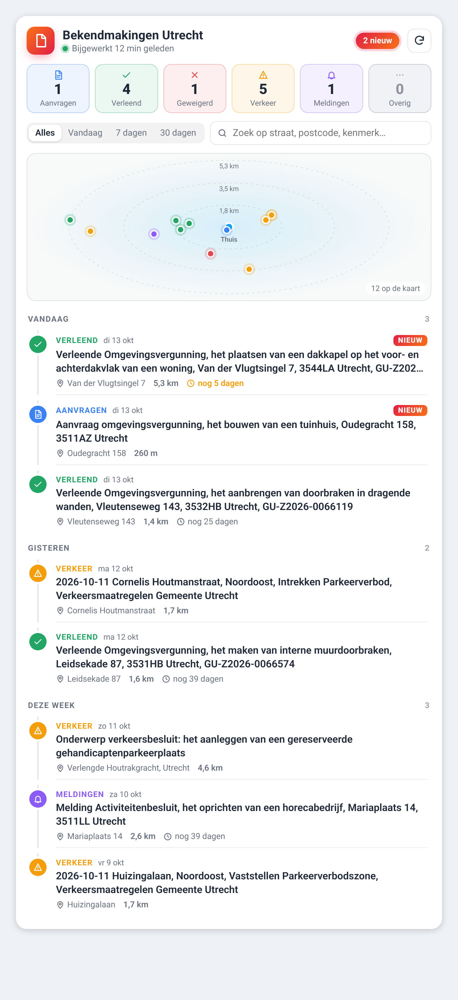
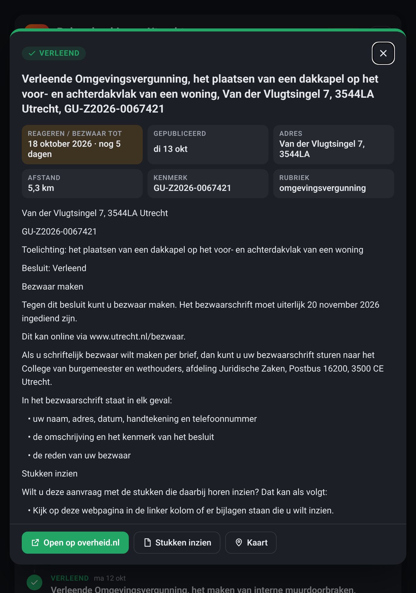

<div align="center">

# 🌌 Gemeente bekendmakingen 2026
**Deze integratie zorgt ervoor dat u op de hoogte bent van uw gemeente als er wijzingen / vergunningen worden aangevraagd door buurt bewoners.**
</div>
<p align="center">
  <!-- Release / License -->
  <a href="https://github.com/DonTranQuiL/bekendmakingen/releases">
    
  </a>
  <a href="https://github.com/DonTranQuiL/bekendmakingen/blob/main/LICENSE">
    
  </a>

  <!-- CI / Quality -->
  <a href="https://github.com/DonTranQuiL/bekendmakingen/actions">
    
  </a>
  <a href="https://github.com/DonTranQuiL/bekendmakingen/actions">
    
  </a>
  <a href="https://github.com/DonTranQuiL/bekendmakingen/actions">
    
  </a>

  <!-- Code Quality -->
  <a href="https://github.com/pre-commit/pre-commit">
    
  </a>
  <a href="https://github.com/astral-sh/ruff">
    
  </a>
  <a href="https://codecov.io/gh/DonTranQuiL/bekendmakingen">
  
</a>

  <!-- Ecosystem -->
  <a href="https://hacs.xyz/">
    
  </a>
  <a href="https://www.home-assistant.io/">
    
  </a>

  <!-- Social / Support -->
  <a href="https://github.com/DonTranQuiL">
    
  </a>
  <a href="https://ko-fi.com/DonTranQuiL">
    
  </a>
  <a href="https://liberapay.com/Malosaaa/donate">
    
  </a>
  <a href="https://liberapay.com/Malosaaa/donate">
    
  </a>
  <a href="https://liberapay.com/Malosaaa/donate">
    
  </a>
  <a href="https://community.home-assistant.io/">
    
  </a>
  <a href="https://discord.gg/qaHPTTKHae">
    
  </a>
</p>

</div>

This custom component for Home Assistant allows you to monitor local government announcements, permits, and decisions for any Dutch municipality. It pulls data directly from the official [officielebekendmakingen.nl](https://zoek.officielebekendmakingen.nl/) RSS feed, keeping you informed about what is happening in your neighborhood.

> **Disclaimer:** This integration relies on the public RSS feed from the Dutch government. If the government changes the URL structure or query parameters of their search engine, this integration may need to be updated. Please use a reasonable scan interval (e.g., 3600 seconds) to avoid spamming the servers.

This integration was created with significant collaboration, testing, and debugging from **TranQuiL (@Malosaaa)**.

***
## 🚀 Key Features

* ✅ **Dashboard card included (v2.1, beta)**: `custom:bekendmakingen-card` with a timeline, map, category counters, filters, search, `NIEUW` badges and a detail popup. It installs together with the integration — no extra resource needed.
* ✅ **Location for every announcement**: coordinates and address come straight from the official publication metadata (`OVERHEIDop.geometrie` / `geometrieLabel`); when a record has none, the address is looked up via PDOK Locatieserver (cached). Distance to your Home zone is calculated.
* ✅ **Smart details**: category, case number (kenmerk), objection/response deadline, full publication text and the "stukken inzien" link where available.
* ✅ **Persistence**: built-in JSON cache, so your dashboard is filled **instantly** after a restart. Already-known announcements are not downloaded again.
* ✅ **Filtering**: choose `ALLES` or only Aanvragen, Verleend, Geweigerd, Verkeersbesluiten, Meldingen or Overig.
* ✅ **10–50 announcements**: configurable in the options.
* ✅ **Counters**: `Nieuw vandaag` plus one sensor per category.
* ✅ **Diagnostics**: Last Update Status, Last Update Time and Consecutive Errors.
* ✅ **Services**: refresh now, or clear all cache and debug files.

## 🛠 Installation

### Method 1: HACS (Recommended)
1. Open **HACS** -> **Integrations**.
2. Click the 3-dots menu (top right) -> **Custom Repositories**.
3. Paste URL: `https://github.com/DonTranQuiL/Bekendmakingen` | Category: **Integration**.
4. Click **Add**, then find "Bekendmakingen" and click **Download**. (For the v2.1 beta, enable *Show beta versions* on the repository in HACS.)
5. **Restart Home Assistant.**

### Method 2: Manual
1. Download the `bekendmakingen` folder from this repo.
2. Copy it into your Home Assistant `custom_components/` directory.
3. **Restart Home Assistant.**

## ⚙️ Configuration

1. Go to **Settings** -> **Devices & Services**.
2. Click **+ Add Integration** and search for **Bekendmakingen**.
3. **Municipality**: Enter the name of your municipality (e.g., `maastricht`).
4. **Instance Name**: Choose a friendly name for your device.
5. **Filters**: Select which types of announcements you want to track. *Leave "ALLES" checked if you want no filters.*
6. **Scan Interval**: How often to check for updates (3600 seconds / 1 hour recommended, minimum 300).
7. **Number of announcements**: 10–50 (default 10).

All options can be changed later via **Configure** on the integration page.

## 🎨 Dashboard card



<details><summary>Light theme and detail popup</summary>




</details>

The card is served by the integration itself and registered automatically, so after installing and restarting you can simply add it:

**Edit dashboard → + Add card → search "Bekendmakingen"**, or in YAML:

```yaml
type: custom:bekendmakingen-card
entity: sensor.bekendmakingen_utrecht
```

What you get:

* **Header** with the municipality, update status (green/red) and a refresh button.
* **Category counters** (Aanvragen, Verleend, Geweigerd, Verkeer, Meldingen, Overig) — tap one to filter.
* **Period filter** (Alles / Vandaag / 7 dagen / 30 dagen) and **search** on street, postcode or kenmerk.
* **Map**: the Home Assistant map with a coloured pin per announcement, or a compact "radar" around your home (`map_style: radar`).
* **Timeline** grouped by *Vandaag*, *Gisteren*, *Deze week* and *Eerder*, with address, distance and deadline countdown.
* **NIEUW badges** for announcements you have not opened yet (remembered per browser); tap the red badge to mark all as read.
* **Detail popup** with the full text, deadline countdown, kenmerk, and buttons to open the publication, the documents and a map.
* Follows your Home Assistant theme (light and dark). Visual editor included.

| Option | Default | Description |
| :--- | :--- | :--- |
| `entity` | – | The main Bekendmakingen sensor (required). |
| `title` | `Bekendmakingen <gemeente>` | Card title. |
| `show_map` | `true` | Show the map. |
| `map_style` | `auto` | `auto` (Home Assistant map) or `radar`. |
| `show_counters` | `true` | Category counters. |
| `show_search` | `true` | Search field. |
| `categories` | all | Default category filter, e.g. `[aanvragen, verleend]`. |
| `max_items` | `25` | Maximum rows in the list. |
| `new_hours` | `24` | How long an unopened announcement counts as new. |
| `max_distance_km` | `0` | Hide announcements further away (0 = show all). |
| `compact` | `false` | Smaller rows, no map. |

## 📊 Sensors & Attributes

### Main sensor
`sensor.bekendmakingen_<municipality>` — state is the newest announcement's title.

| Attribute | Content |
| :--- | :--- |
| `date`, `time` | Publication date and time of the newest announcement. |
| `link` | URL of the publication on officielebekendmakingen.nl. |
| `summary` | Short description. |
| `detailed_description` | The full publication text. |
| `history` | The other announcements (same fields as below). |
| `items` | **All** announcements, newest first (v2.1). |
| `category`, `address`, `latitude`, `longitude`, `published`, `id`, `municipality` | Details of the newest announcement (v2.1). |

Each entry in `items` / `history` contains: `id`, `title`, `link`, `published` (ISO 8601), `date`, `time`, `category`, `rubriek`, `summary`, `detailed_description`, `address`, `postcode`, `latitude`, `longitude`, `geo_source` (`metadata` or `pdok`), `distance_km`, `case_number`, `deadline` (ISO date), `inzage_url`.

`items`, `history`, `summary` and `detailed_description` are not stored in the recorder database.

### Counters
`sensor.bekendmakingen_<municipality>_nieuw_vandaag` and one sensor per category (`…_aanvragen`, `…_verleend`, `…_geweigerd`, `…_verkeer`, `…_meldingen`, `…_overig`).

### Diagnostics
Last Update Status, Last Update Time, Consecutive Errors.

## 🛠 Services

| Service | Description |
| :--- | :--- |
| `bekendmakingen.refresh` | Forces an immediate check of the feed. |
| `bekendmakingen.clear_files` | Deletes the local `.json` cache, the geocode cache and the `.txt` debug logs. |

A raw debug file (`bekendmakingen_debug_<municipality>.txt`) is only written when debug logging is enabled for `custom_components.bekendmakingen`.

## 📝 Markdown alternative

Prefer a plain Markdown card? This still works (replace `maastricht` with your municipality):

```yaml
type: markdown
content: |2-

    
    
    **{{ item.date }}** [**{{ item.title }}**]({{ item.link }})
    *{{ item.summary | striptags | truncate(150, true, '...') }}*

    ---
    
```
[hacs]: https://hacs.xyz
[hacs_badge]: https://img.shields.io/badge/HACS-Custom-41BDF5.svg?style=for-the-badge
[maintenance_badge]: https://img.shields.io/badge/Maintained%3F-yes-green.svg?style=for-the-badge
